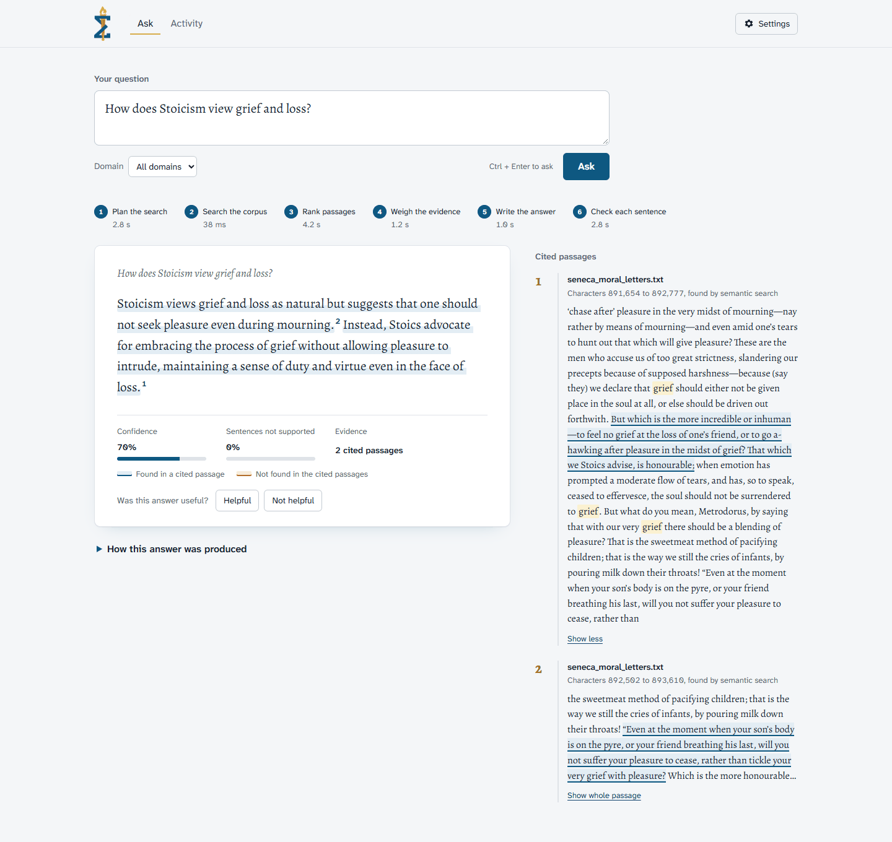
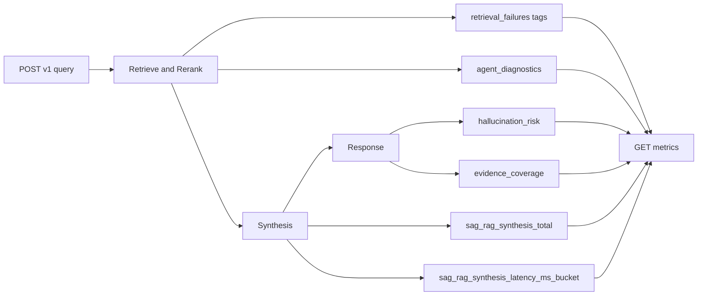
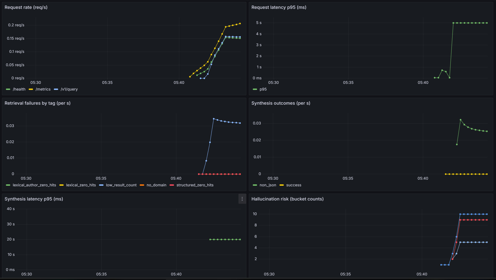

# SAG-RAG

Speculative -> Agentic -> Graph RAG: retrieval-augmented question answering
over your own documents. SAG-RAG plans the search, runs semantic and keyword
retrieval in parallel, reranks the passages, optionally consults a knowledge
graph, has the evidence judged, and writes an answer whose citations point at
exact character spans in the source files. It ships as a FastAPI backend over
Qdrant, Elasticsearch, Neo4j and a local Ollama model, with a web UI,
Prometheus/Grafana observability, and optional API-key multi-tenancy.

**Docs:** component and data-flow reference in [`docs/architecture.md`](docs/architecture.md).
With the backend running, the live API schema is at **`/docs`** (Swagger UI)
and **`/redoc`**.

## Architecture

```mermaid
---
config:
  look: neo
  theme: redux
---
flowchart LR

  subgraph A[1. Request and Planning]
    direction TB
    UI[Web UI]
    API[FastAPI /v1/query]
    PLAN[Speculative Planner]
    ROUTE[Domain Router]
    LLM[Ollama LLM]
    UI --> API
    API --> PLAN
    PLAN --> ROUTE
    PLAN --> LLM
  end

  subgraph B[2. Retrieval Layer]
    direction TB
    RETR[Retrieval Fanout]
    VEC[Vector Search\nQdrant]
    LEX[Lexical Search\nElasticsearch]
    STR[Structured Lines\nfrom lexical hits]
    AUTH[Author Lexical Search\nConditional ES source keyword]
    RETR --> VEC
    RETR --> LEX
    LEX --> STR
  end

  subgraph C[3. Evidence Processing]
    direction TB
    AGG[Aggregate + Normalize]
    POL[Policy + Freshness Filters]
    DEDUP[Deduplicate Evidence]
    BIAS[Author Bias\nsoft-strong]
    RR[Re-ranker\nCross-Encoder]
    AGG --> POL --> DEDUP --> BIAS --> RR
  end

  subgraph D[4. Optional Graph Reasoning]
    direction TB
    G[Knowledge Graph\nNeo4j]
    J[Judge / Contradictions]
    G --> J
  end

  subgraph E[5. Synthesis and Output]
    direction TB
    SYN[Synthesis and Fallback\nnon_json timeout error]
    OUT[Answer + Provenance + Scores]
    SYN --> OUT
  end

  subgraph F[6. Telemetry]
    direction TB
    OBS[Metrics + Diagnostics]
    RF[retrieval_failures]
    AD[agent_diagnostics]
    SM[synthesis outcomes + latency]
    OBS --> RF
    OBS --> AD
    OBS --> SM
  end

  subgraph G2[7. Ingestion Pipeline]
    direction TB
    DOCS[Docs]
    CHUNK[Chunk + Embed]
    ES[Elasticsearch Index]
    QDR[Qdrant Vectors]
    NEO[Neo4j Graph]
    DOCS --> CHUNK
    CHUNK --> ES
    CHUNK --> QDR
    CHUNK --> NEO
  end

  ROUTE --> RETR
  API -. explicit author terms .-> AUTH
  VEC --> AGG
  LEX --> AGG
  STR --> AGG
  AUTH --> AGG
  RR --> SYN
  SYN --> LLM
  RR -.-> G
  J -.-> SYN
  J -.-> LLM
  OUT --> OBS
```



## Web UI

The web app (`web/`, served by nginx at **http://localhost:8080**) is built for
checking answers, not just reading them:

- the answer streams in while a step indicator shows the pipeline (plan,
  search, rank, weigh evidence, write) with the time each step took;
- every cited passage sits beside the answer with its file name, exact
  character span, and the question's terms highlighted;
- with verification on, each answer sentence is underlined as supported or
  not, links to its source, and the exact supporting sentence is highlighted
  inside that passage;
- confidence, risk of unsupported claims, and the evidence count sit under the
  answer, and "How this answer was produced" lists the searches run, retriever
  results, detected problems in plain language, and timings;
- Helpful / Not helpful feedback is tied to the exact answer (`query_id`);
- an Activity tab lists recent questions and feedback for your tenant;
- Settings holds the API address, an API key (kept for the browser tab only),
  your user id, and the theme (light, dark, or system).

It is plain HTML, CSS and ES modules with no build step. All server text is
inserted as text nodes, and nginx sends a strict Content-Security-Policy. The
theme is light by default (dark is available in Settings), in the navy and
gold of the SAG-RAG emblem.

<p align="center">
  
</p>
<p align="center"><em>Figure: a live answer from the local stack (qwen2.5:7b on Ollama, sentence verification on). Both sentences were checked against the cited passages of Seneca's Moral Letters; the supporting sentences are underlined in the margin and the query terms are highlighted.</em></p>

## What it does

- **Speculative query planning.** An LLM proposes an intent and alternative searches; the
  original question is always searched first and the plan is sanitized (the
  model cannot pick a domain or change policy). A rule-based plan from the
  domain packs is the fallback.
- **Hybrid retrieval.** Semantic (Qdrant) and keyword (Elasticsearch) search
  run in parallel for every sub-query; table and key/value lines are pulled
  out of keyword hits; author-aware search runs when the question names an
  author.
- **Evidence processing.** Policy and freshness filters, deduplication, author
  bias with gap-aware fallback, and a cross-encoder reranker.
- **Optional knowledge graph.** Entities, claims, relations and heuristic
  contradiction links in Neo4j feed the judge as extra signals.
- **Judge and synthesis.** The judge picks trusted passages and a confidence;
  synthesis writes a short answer. Prompts label evidence `E1`, `E2`, ... and
  request a JSON schema, so replies stay small enough for tight token limits
  (echoing 36-character chunk ids used to truncate them); a reply that is
  still cut off keeps its complete sentences. Citations are validated against
  the retrieved passages, and their source and offsets always come from the
  evidence, never from the model.
- **Sentence-level verification (opt-in).** Each answer sentence is checked
  against the passages it cites with a small local NLI cross-encoder
  (sentence-sized premises, attribution phrases stripped, contradictions only
  from related sentences). The response marks every sentence supported,
  unsupported, or contradicted, and hallucination risk becomes the measured
  share of unsupported sentences. Optionally the answer is withheld when too
  little of it is supported.
- **Graceful degradation.** A missing service, a non-JSON model reply, or an
  unreachable Redis lowers quality but never takes the request path down, and
  every degraded path is tagged and counted.

## How a query flows

1. The client sends a question to `/v1/query` (or `/v1/query/stream`).
2. The planner emits an intent and sub-queries.
3. Each sub-query is embedded once (Redis-cached) and searched with the
   vector and keyword retrievers; structured lines come from the keyword hits.
4. Author search runs when explicit author terms are detected.
5. Results are filtered, deduplicated, author-biased, and reranked.
6. The graph layer optionally adds entities, claims and relations.
7. The judge validates evidence and sets a confidence.
8. Synthesis returns the answer with validated provenance (falling back to
   formatted evidence on `non_json`, `timeout` or `error`), and verification
   (when enabled) checks each sentence against the cited passages.
9. Failure tags, diagnostics, and latencies are recorded; the answer is
   audited under a fresh `query_id`.

## Quickstart (Docker Compose)

Prerequisites: Docker. For answers you also need an Ollama model, either
[Ollama](https://ollama.com) on the host or the bundled GPU container (below).

```bash
cp .env.example .env                 # placeholders only; edit as needed
python tools/fetch_corpus.py         # public-domain Stoic texts -> data/docs/stoicism
cd infra
docker compose up -d --build         # add --profile llm for the Ollama container
docker compose exec ollama ollama pull qwen2.5:7b   # only with --profile llm
```

- Web UI: http://localhost:8080
- API docs: http://localhost:8000/docs
- Readiness (which dependencies answer): http://localhost:8000/ready

Documents live in `data/docs/<domain>/` as `.txt`, `.csv` or `.json` files
(one folder per domain; file names starting with the author's name help
author-aware retrieval). `tools/fetch_corpus.py` downloads Seneca's Moral
Letters and Minor Dialogues, On Benefits, and Epictetus' Golden Sayings,
strips publisher boilerplate and translator notes, unwraps paragraphs, and
writes a `SOURCES.md` manifest. Ingest, then poll the job:

```bash
curl -sS -X POST http://localhost:8000/v1/ingest
curl -sS http://localhost:8000/v1/ingest/<job_id>
```

Compose reads `${...}` values from `infra/.env` (for example `HF_CACHE_DIR`,
and `NEO4J_PASSWORD` when `GRAPH_ENABLED=true`; keep it equal to the one in
`.env`). The `llm` profile runs `ollama/ollama` on an NVIDIA GPU and publishes
port 11434, so the default `OLLAMA_URL=http://host.docker.internal:11434`
works unchanged. `docker-compose.override.yml` (loaded automatically) mounts
`app/` into the backend for development; run
`docker compose -f docker-compose.yml up` for a production-like stack without
the mount. The backend image runs as a non-root user (uid 1000 by default; on
Linux build with `--build-arg APP_UID=$(id -u)` if your `data/` directory is
owned by another uid).

To serve the UI from somewhere other than the bundled nginx, set
`CORS_ORIGINS` to that origin and put the API address in the UI's Settings.

## Configuration

Every setting has a default in `app/config.py`; [`.env.example`](.env.example)
shows the common ones with placeholder values.

- **LLM:** `OLLAMA_URL`, `OLLAMA_MODEL`, `LLM_MAX_CONCURRENT`,
  `LLM_CONNECT_TIMEOUT_S`, `LLM_READ_TIMEOUT_S`, `SYNTHESIS_STREAM_TIMEOUT_S`,
  `JUDGE_TIMEOUT_S`, `SYNTHESIS_TIMEOUT_S`, `*_MAX_TOKENS`.
- **Planner and retrieval:** `PLANNER_MAX_QUERIES`, `RETRIEVER_TIMEOUT_S`,
  `RERANKER_TOP_K`, `RERANK_MAX_CANDIDATES` (default 40; candidates are chosen
  by reciprocal rank fusion across retrievers before the cross-encoder runs),
  `MAX_EVIDENCE_SNIPPETS`, `WARM_MODELS_ON_STARTUP` (default on: embedding,
  reranker and NLI models load in the background at startup).
- **Verification:** `VERIFY_ENABLED` (default off; downloads a ~330 MB model on
  first use), `VERIFY_MODEL_NAME`, `VERIFY_MODEL_REVISION`, `VERIFY_THRESHOLD`
  (default 0.5), `VERIFY_TIMEOUT_S`, `ABSTAIN_BELOW_SUPPORT` (0 disables),
  `GRAPH_NLI_CONTRADICTIONS` (confirm graph contradictions with the same model).
- **Confidence calibration:** `CONFIDENCE_ALIGNMENT_FLOOR` (default 0.55),
  `CONFIDENCE_ALIGNMENT_TOP_SCORE_MIN` (default -6.0), `MIN_RESULTS_COUNT`,
  `MIN_TOP_RERANK_SCORE`.
- **Stores:** `QDRANT_URL`, `ELASTIC_URL`, `NEO4J_URI`, `NEO4J_USER`,
  `NEO4J_PASSWORD`, `GRAPH_ENABLED`.
- **Domains:** `DOMAIN_KEYWORDS`, `DOMAIN_ALIASES`, `DOMAIN_MIN_KEYWORD_HITS`
  (default 2), `DOMAIN_FALLBACKS`, `DOMAIN_INDEX_MAP` (shared layout only),
  `DOMAIN_PACKS_PATH`, `QUERY_TERM_SYNONYMS`, `AUTHOR_INDEX_PATH`.
- **Policy:** `POLICY_BLOCKLIST`, `POLICY_ALLOWLIST`,
  `POLICY_SOURCE_TYPES_ALLOW/BLOCK`, `POLICY_DOMAINS_ALLOW/BLOCK`,
  `POLICY_RULES` (JSON list of `{action, domains, source_types, contains,
  not_contains}`; first match wins), `DEFAULT_FRESHNESS_DAYS`.
- **Redis (best effort):** `REDIS_URL`, `REDIS_RATE_LIMIT_ENABLED`,
  `REDIS_CACHE_ENABLED`, `QUERY_CACHE_TTL_S`, `EMBED_CACHE_TTL_S`.
- **Auth, tenancy, rate limits:** `AUTH_ENABLED`, `API_KEYS`, `API_KEY_MAP`,
  `TENANT_ISOLATION`, `RATE_LIMIT_PER_MINUTE`, `TRUSTED_PROXY_HOPS`,
  `CORS_ORIGINS`.
- **Exports:** `AUDIT_EXPORT_PATH`, `LEARNING_EXPORT_PATH`,
  `LEARNING_MIN_RATING` (server-side paths; clients never choose them).
- **Observability:** `OTEL_ENABLED`, `OTEL_SERVICE_NAME`,
  `OTEL_EXPORTER_OTLP_ENDPOINT`.

### Domain routing

```
DOMAIN_KEYWORDS='{"stoicism":["stoic","seneca","epictetus","marcus"],"finance":["earnings","revenue","sec"]}'
DOMAIN_MIN_KEYWORD_HITS=2
```

Keywords match at word starts ("stoic" matches "stoicism", "art" does not
match "start"). A client can pass `preferences.domain`, but only for a domain
that is configured or already ingested in its own namespace; anything else is
rejected with 422. `GET /v1/domains` lists the valid values.

### Author queries and fallback

- If the question names an author (for example "Seneca"), results are biased
  toward that author.
- Query terms are expanded with synonyms (for example "fear" to dread,
  terror, anxiety, timor, metus):
  `QUERY_TERM_SYNONYMS={"fear":["dread","terror","anxiety","timor","metus"]}`.
- If no passage by that author mentions the query terms, the response says so
  and falls back to other sources (`author_gap`).
- Ingest maintains a lightweight author to source index to speed author
  filtering.

## Failure analysis

Retrieval and synthesis problems are tagged on every response
(`retrieval_failures`) and counted in `sag_rag_retrieval_failures_total`:
`no_domain`, `policy_blocked`, `cross_domain_conflict`, `no_results`,
`low_result_count`, `low_top_score`, `author_gap`,
`vector|lexical|structured|lexical_author` + `_timeout|_error|_zero_hits`,
`synthesis_timeout|synthesis_error`, and, with verification on,
`unsupported_claims`, `contradicted_claims` and `abstained`. The streaming
endpoint reports the same tags as the buffered one.



With verification on, `hallucination_risk` is the share of answer sentences
that no cited passage supports (`hallucination_risk_method: "nli"`) and
`sag_rag_claims_total{status=...}` counts sentences by outcome. Without it, the
score falls back to the judge's confidence plus fixed penalties
(`"heuristic"`), which is an estimate, not a measurement.

## Observability

The backend exposes Prometheus text metrics at `/metrics` (and `/v1/metrics`):
request counts and latency histograms (labelled by route template, so job ids
and scanner URLs never create new series), retrieval failures, synthesis
outcomes and latency, hallucination risk and evidence coverage. Histograms
include `_sum` and `_count`.

An opt-in stack (Prometheus + Grafana + OpenTelemetry collector) ships behind a
Compose profile so the core stack stays light:

```bash
cd infra
docker compose --profile observability up
```

- **Prometheus:** http://localhost:9090 (scrapes `backend:8000/metrics`).
- **Grafana:** http://localhost:3000 (anonymous viewer enabled; admin/admin;
  local use only). A provisioned "SAG-RAG Overview" dashboard shows request
  rate and latency, retrieval failures, synthesis outcomes and p95 latency, and
  hallucination risk.
- **OTel collector:** receives OTLP traces on `4317`/`4318`. Set
  `OTEL_ENABLED=true` (and `OTEL_EXPORTER_OTLP_ENDPOINT=http://otel-collector:4317`)
  so the backend exports spans; the collector logs them (add a Jaeger or Tempo
  exporter to visualize).

<p align="center">
  
</p>
<p align="center"><em>Figure: the provisioned "SAG-RAG Overview" Grafana dashboard: request rate, latency p95, retrieval failures by tag, and synthesis outcomes, scraped live from <code>/metrics</code>.</em></p>

## Security

Auth is **opt-in** so local development works without a key. For any
deployment beyond localhost, set:

```bash
AUTH_ENABLED=true
TENANT_ISOLATION=true
API_KEY_MAP={"prod-key-abc":"acme","prod-key-def":"globex"}
# or API_KEYS=key1,key2 (each gets a tenant id derived from a hash of the key)
```

- Every endpoint requires `x-api-key` except `/health`, `/ready`, `/metrics`
  and the OpenAPI docs. Keys are compared in constant time; missing or unknown
  keys get `401`.
- **Tenant isolation is enforced server-side.** The tenant comes from the key;
  a body or query-string tenant is ignored for authenticated requests.
  Storage names keep tenants and domains apart (`docs_t_{tenant}` and
  `docs_t_{tenant}__d_{domain}`), names are validated slugs, and an isolated
  search never falls back to shared data. Audit rows, feedback, exports,
  ingest job status, source deletion, and graph reads and writes are all
  scoped to the caller's tenant.
- Without auth, `TENANT_ISOLATION` uses the supplied tenant (or user id), so it
  is a convenience, not a security boundary; the backend logs a warning.
- The planner's output is untrusted: it cannot choose a domain or alter
  policy, and synthesis output cannot add or overwrite response fields.
- Exports (`/v1/audit/export`, `/v1/learning/export`) return NDJSON downloads
  or write to server-configured paths; a client-supplied `path` is rejected.
- Rate limits key on the tenant when authenticated, otherwise on the client
  address; `X-Forwarded-For` is only trusted for `TRUSTED_PROXY_HOPS` proxies.
- The web container sends a strict CSP and renders all server text as text.
- `.env` and `infra/.env` are git-ignored; never commit real keys. Provide them
  through the environment or a secret store (for Compose, an injected env file
  or Docker secrets), not baked into images.

## API reference

The always-current schema (request and response models included) is at
`/docs`, `/redoc` and `/openapi.json`. Highlights:

| Method | Path | Purpose |
|---|---|---|
| POST | `/v1/query` | Buffered answer + provenance + diagnostics (cached) |
| POST | `/v1/query/stream` | SSE: `stage`, `meta`, `token`, `final` (same body as `/v1/query`), `error`, `done` |
| GET | `/v1/domains` | Domains valid for `preferences.domain` |
| POST | `/v1/ingest` | Start a background ingest job (202, `{job_id}`) |
| GET | `/v1/ingest/{job_id}` | Job status: `queued`, `running`, `succeeded`, `completed_with_errors`, `failed` |
| DELETE | `/v1/ingest/source/{source}` | Delete a source from the caller's namespaces |
| GET | `/v1/audit` | Recent queries (cursor paging) |
| POST | `/v1/audit/export` | NDJSON download, or `{"save": true}` to the configured path |
| POST | `/v1/feedback` | Rating 1 to 5, optional comment and `query_id` |
| GET | `/v1/feedback/list` | Recent feedback |
| POST | `/v1/learning/export` | Interactions rated at or above `min_rating` |
| POST | `/v1/graph/summary` | Graph reasoning for chunk ids |
| GET | `/health`, `/ready`, `/metrics` | Liveness, dependency readiness, Prometheus |

Endpoints are also mounted at the root (`/query`, ...) for backwards
compatibility.

## Evaluation

A small labeled query set lives in `data/eval/queries.jsonl`. Score a running
stack with:

```bash
python tools/ablation_eval.py --base-urls http://localhost:8000 \
  --queries data/eval/queries.jsonl --output ablation_results.jsonl \
  --score --ground-truth data/eval/queries.jsonl --k 5
```

This produces retrieval recall@k / hit rate and answer-quality scores
(LLM-judge faithfulness plus a lexical-overlap baseline). See
[`data/eval/README.md`](data/eval/README.md). The set has six single-domain
questions, so scores are indicative only; no benchmark numbers are published
yet.

The verifier has its own sanity check: `python tools/verify_eval.py` runs the
real NLI model over hand-labeled claims in `data/eval/nli_cases.jsonl`
(currently 11 of 12 correct; the miss is a loose paraphrase it conservatively
marks unsupported). Twelve cases is a smoke test, not a benchmark.

## Upgrading from earlier versions

- **Re-ingest your documents.** Character offsets were computed incorrectly
  before (cited spans drifted), chunk ids now include the namespace, and graph
  nodes now carry a tenant key.
- With `TENANT_ISOLATION=true`, data moves to `docs_t_{tenant}...` names; a key
  in `API_KEYS` without an `API_KEY_MAP` entry now maps to a hash-derived
  tenant instead of the raw key.
- The Gradio app is replaced by the web UI on port 8080, and the backend's
  `/ui` page is removed.
- Export endpoints no longer accept `path`; feedback ratings must be 1 to 5;
  `preferences.domain` must be a known domain.

## How it differs from other RAG approaches

These are design intentions; they have not been benchmarked against the
alternatives yet.

| Technique | Strengths | Limitations | What SAG-RAG adds |
|---|---|---|---|
| Naive RAG (single retriever, no planning) | Simple, fast to build | Irrelevant context, weaker grounding | Planned sub-queries and parallel retrievers |
| Vector-only RAG | Semantic similarity | Misses exact matches, brittle for numbers | Keyword and structured retrieval plus reranking |
| BM25-only RAG | Exact-match recall | Poor semantic coverage | Embeddings and query planning |
| Hybrid RAG (vector + BM25) | Better recall | Still noisy; limited verification | Judge, validated provenance, optional graph signals |
| Rerank-only pipelines | Higher relevance | No verification | Explicit judge and contradiction signals |
| Graph-RAG (entity graph) | Explainability | Shallow reasoning | Claims, relation and contradiction signals for the judge |
| Toolformer-style agentic RAG | Flexible tool use | Hard to audit | Fixed, observable stages with audit logs |

## Known limitations

- **Confidence is uncalibrated.** It comes from the judge model plus graph
  penalties and an alignment floor. Hallucination risk is only measured when
  verification is on; otherwise it is derived from that confidence.
- **Verification is a small model.** It cannot read support that a source
  expresses as a rhetorical question ("what is baser than to chase after
  pleasure in mourning?"), so such sentences may show as unsupported; questions
  are never allowed to count as contradictions. It checks sentences only
  against the passages the answer cites and adds latency (about 1.5 seconds for a
  four-sentence answer over three passages on a 16-thread desktop CPU; the
  model is warmed up at startup). It has only been sanity-checked on twelve
  labeled claims.
- **Graph contradictions are partly heuristic.** Candidates are similar
  sentences about a shared entity; they are confirmed by NLI when
  `GRAPH_NLI_CONTRADICTIONS` is on, otherwise by opposite negation. Relation
  conflicts are differing predicates for one entity pair.
- **Evaluation scope.** The bundled eval set is small and single-domain.
- **Answers vary between runs.** GPU inference is not fully deterministic
  even at temperature 0, so the same question can produce differently worded
  answers (and verification results).
- **Single-node infra.** Qdrant, Elasticsearch, Neo4j and Redis run
  single-node via Compose. Redis is best effort; the ingest worker is
  in-process (one job at a time per process), not a distributed consumer.
- **Training.** LoRA or fine-tuning is out of scope; `learning/export` only
  emits highly rated interactions.
- **Route duplication.** Endpoints are mounted at both `/v1/*` and `/*` for
  compatibility.

See [`docs/architecture.md`](docs/architecture.md#known-limitations) for details.
